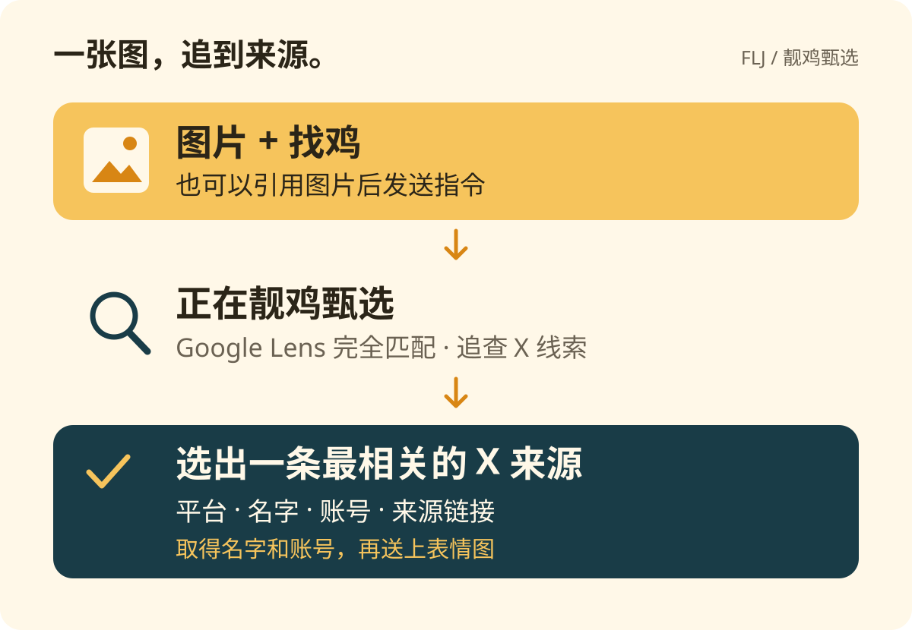

# 靓鸡甄选 · FLJ Finder

给 AstrBot 一张图，查找 **X / Twitter 的同图帖子和账号**。通过 Google Lens 完全匹配检索，没有直接命中时，再从已有同图页面追查 X 线索。最终只返回最相关的一条 X 来源或账号线索。



## 发图，找鸡

两种用法：发送 **图片 + `找鸡`**；或引用一张图片，再发送 **`找鸡`**。也支持 `/找鸡` 和 AstrBot 配置的唤醒前缀。多图消息取第一张，当前消息的图片优先于引用图片。

```text
你： [图片] 找鸡
Bot：正在靓鸡甄选
Bot：🎯 靓鸡甄选结果
平台：X
名字：来源接口提供的显示名
账号：@账号
来源：X 帖子链接

Bot： [成功表情图]
```

结果消息固定为标题、平台、名字、账号和来源五行。只取得账号或帖子线索时也使用相同格式；选出的 X 结果有名字和账号时会发送成功表情图。名字无法取得时显示“未提供”。

<p></p>

## 怎么找

1. **搜同图**：Google Lens 查询完全匹配。默认直连，填写 `serpapi_api_key` 后改用 SerpApi。直接命中 X 时，按帖子 ID 去重并补充作者信息。
2. **追查 X**：没有直接命中时，从同图页面的标题、链接和署名提取线索。默认调用一次 LLM，分析最多 6 个来源、提取最多 3 个账号候选；模型只接收来源文字，限时 30 秒，失败后继续规则检索。通过 [Twitter 插件](https://github.com/Ars1027/astrbot_plugin_twitter) 的 Nitter 搜索，未取得结果时使用 SerpApi 限定 X/Twitter 域名搜索，必要时读取最多 3 个来源页面补充线索。
3. **核验来源**：通过 Twitter 插件核对账号、帖子 ID 和实际作者，最多检查 3 条候选帖子并比对配图；账号主页可补查最近 3 条帖子。被引用帖配图吻合时，改为返回被引用帖。Google 完全匹配本身作为同图证据；查询到账号仅表示账号存在。
4. **返回一条**：优先返回同图结果，综合具体帖子、引用关系、明确署名和支持网站数排序，同级保持 Google 顺序。没有同图结果时，排序复用本轮核验取得的关注者数，优先选择已取得关注者数最多的账号；数量相同则比较线索强度和支持网站数。数量均无法取得时按线索比较，证据相当则提示无法确定。账号线索及关注者数量不证明图片归属。

SerpApi 需要独立的 [API Key](https://serpapi.com/manage-api-key)，Lens 和 X 网页搜索均使用 `safe=off`。一次找图最多调用 **3 次 SerpApi 搜索**（1 次 Lens、2 次 X 网页搜索），不自动重试；额度与计费以服务商账户为准。

## 安装

需要 **Python 3.12+、AstrBot 4.28+**。当前声明的平台为 **OneBot / aiocqhttp（QQ）**。

1. 在项目目录执行 `python scripts/build_zip.py`，生成 `dist/astrbot_plugin_flj_finder.zip`。
2. 在 AstrBot 管理面板的插件页选择“上传插件”，选择该 ZIP。
3. 在插件配置中填写允许的 QQ 群号或私聊 QQ 号，保存并重载后发送图片加 `找鸡`。

也可以将整个项目目录放入 AstrBot 的 `data/plugins/astrbot_plugin_flj_finder`。在 AstrBot 根目录、**AstrBot 使用的 Python 环境**执行下面的命令，然后在面板重载插件：

```bash
python -m pip install -r data/plugins/astrbot_plugin_flj_finder/requirements.txt
```

Docker 部署应将插件放入挂载的 `data/plugins`，依赖安装在 AstrBot 容器内。仅在正在运行的容器内安装的依赖不会随容器重建保留；重建后由插件管理器重新安装依赖，或在自己的镜像构建中安装 `requirements.txt`。

也可在 AstrBot 插件管理页使用仓库地址 `https://github.com/Ars1027/astrbot_plugin_flj_finder` 安装。根目录 `logo.png` 为插件列表头像，`CHANGELOG.md` 可供管理面板读取更新记录。

## 配置

在 AstrBot 插件配置页编辑，保存后重载生效。默认仅支持 OneBot / aiocqhttp QQ 平台。群聊只检查群号，私聊只检查发送者 QQ 号；未放行时静默跳过，不下载图片或消耗检索额度。两项白名单默认均为空，需要先配置。

例如允许群 `123456789`、允许 QQ `987654321` 私聊，分别填写：

```json
{
  "group_whitelist": ["123456789"],
  "private_qq_whitelist": ["987654321"]
}
```

| 配置 | 默认值 | 说明 |
| --- | --- | --- |
| `group_whitelist` | `[]` | 允许的 QQ 群号；空名单不允许群聊使用 |
| `private_qq_whitelist` | `[]` | 允许私聊使用的 QQ 号；不放行群聊 |
| `proxy` | 空 | Google Lens 和 X 追查的 HTTP(S) 代理；空为直连 |
| `serpapi_api_key` | 空 | Google Lens 的 SerpApi Key；填写后启用 API 通道 |
| `search_timeout` | `30` | Google Lens 检索上限，单位秒 |
| `x_lookup_timeout` | `20` | 没有直接命中 X 时，来源追查的总上限，范围 5–30 秒 |
| `use_title_llm` | `true` | 没有直接 X 同图结果时调用模型解析来源文字 |
| `log_title_candidates` | `false` | 诊断时记录模型候选及原文片段 |
| `title_llm_provider_id` | 空 | 使用已有文本模型提供商 ID；留空跟随当前会话 |
| `cooldown_seconds` | `15` | 同一用户在同一会话的请求间隔 |
| `send_success_image` | `true` | 选出的 X 结果同时有名字和账号时发送 `assets/success.png` |

旧配置中的 `engines` 和 `saucenao_api_key` 不再生效，升级后统一使用 Google Lens。

代理地址里的 `127.0.0.1` 指容器本身；请填写容器实际能访问的代理地址。代理与 API Key 不写入插件日志，配置仍由 AstrBot 保存在磁盘。

图片上限为 10 MB、3000 万像素。无需纠正方向且最长边不超过 1600 像素的静态 JPG、PNG、WebP 保留原始字节，避免重新编码影响同图检索；其他图片纠正方向、缩放并转为 JPEG，透明区域填白，动态图只取第一帧。API 上传超过 500 KB 时再按服务上限压缩。不保留图片检索缓存；命令冷却按会话和发送者隔离，最多同时处理两次请求。
